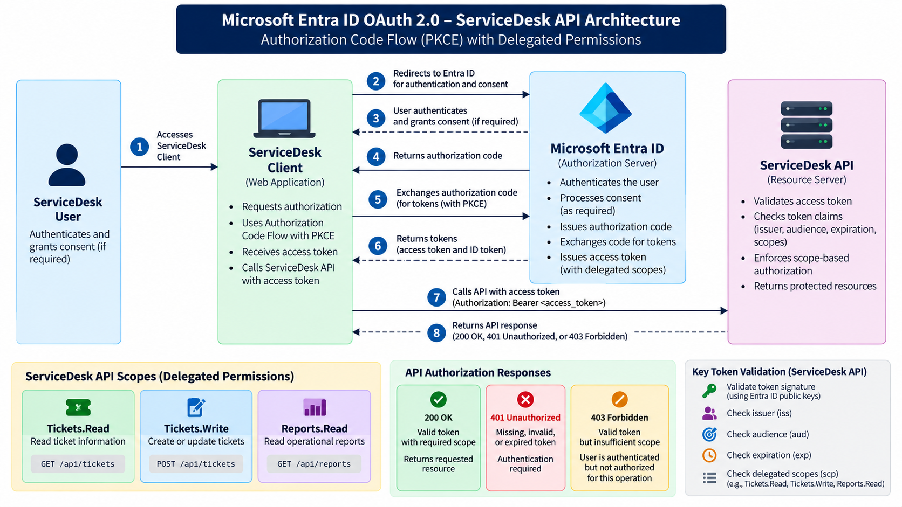
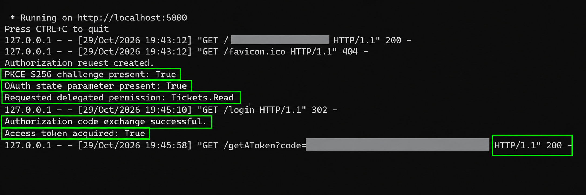
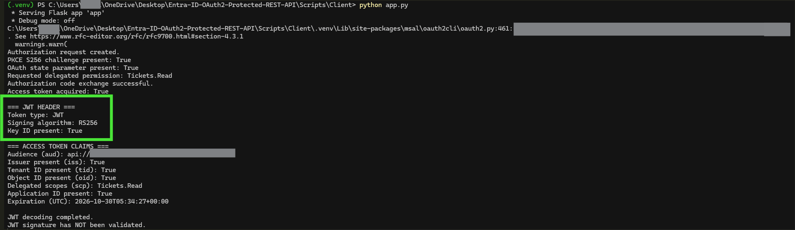
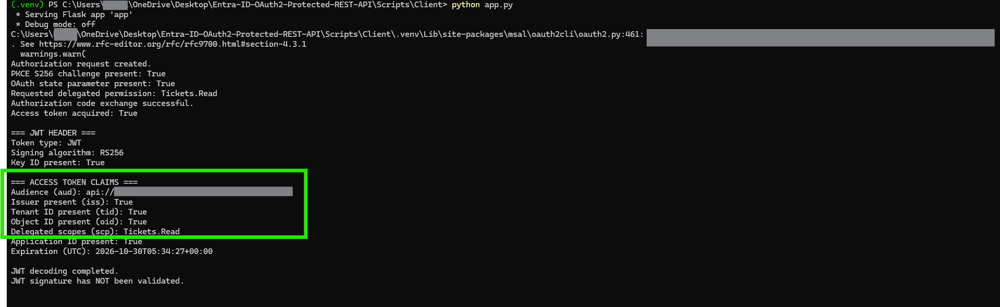
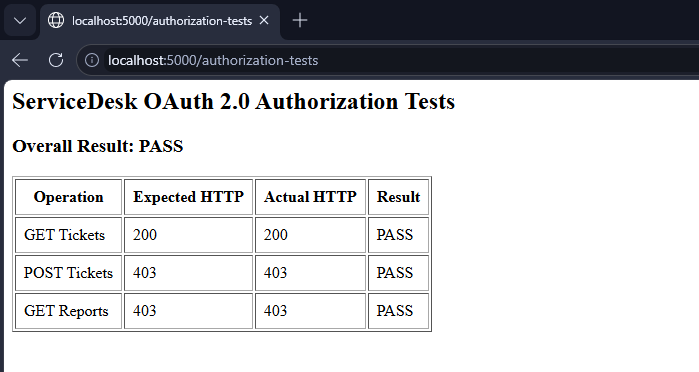
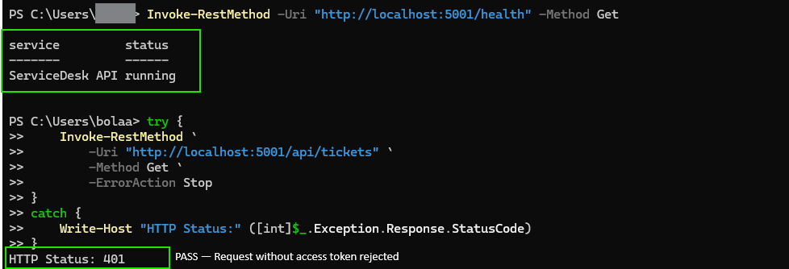

# Microsoft Entra ID OAuth 2.0 — Protected ServiceDesk REST API


## Project Overview


This hands-on Identity and Access Management (IAM) project demonstrates how Microsoft Entra ID can secure a custom REST API using **OAuth 2.0 Authorization Code Flow with PKCE**, delegated API permissions, and JSON Web Token (JWT) validation.


The project implements a Python Flask client application that authenticates users through Microsoft Entra ID, obtains an OAuth 2.0 access token, and uses that token to access a protected ServiceDesk REST API.


The API validates access tokens and enforces permission-based authorization before allowing access to protected resources.


## Business Scenario


An organization operates an internal ServiceDesk application that allows employees to view support tickets, create tickets, and access reporting information.


The organization needs to ensure that employees can only access API resources for which they have been granted appropriate permissions.


Rather than allowing unrestricted API access, the organization integrates the application with Microsoft Entra ID and implements OAuth 2.0 delegated authorization.


Employees authenticate using their organizational identities, while the ServiceDesk API independently validates access tokens and enforces authorization requirements.


## Business Problem


Without proper API authentication and authorization controls, applications may expose sensitive business resources to unauthorized users or clients.


The organization needs to:


\- Authenticate employees through a centralized identity provider.

\- Issue access tokens for a specific protected API.

\- Enforce least-privilege delegated permissions.

\- Validate JWT signatures, issuers, audiences, and expiration.

\- Reject requests with missing, invalid, or expired tokens.

\- Prevent users from performing actions beyond their authorized scopes.


## Solution Implemented


A custom OAuth 2.0 solution was implemented using Microsoft Entra ID, Python, and Flask.


The solution consists of:


1\. **Microsoft Entra ID:** Identity provider and OAuth authorization server.

2\. **ServiceDesk Client:** Flask application that initiates the OAuth authorization flow and requests delegated permissions.

3\. **ServiceDesk API:** Protected Flask REST API that processes authorized requests.

4\. **JWT Validator:** Validates Microsoft Entra ID access tokens using cryptographic signature verification and token claims.

5\. **API Scope Enforcement:** Determines whether the access token contains the required permission for each protected endpoint.


## Architecture





### Authentication and Authorization Flow


1\. A user accesses the ServiceDesk Client application.

2\. The client redirects the user to Microsoft Entra ID for authentication and authorization.

3\. Microsoft Entra ID authenticates the user and processes the authorization request.

4\. The OAuth 2.0 Authorization Code Flow with PKCE is used to obtain an access token.

5\. The ServiceDesk Client sends the access token to the protected ServiceDesk API.

6\. The API validates the token's signature and relevant security claims.

7\. The API evaluates the delegated permissions in the token.

8\. The API returns the requested resource or rejects the request based on authorization requirements.


## Technologies Used


\- Microsoft Entra ID

\- OAuth 2.0

\- Authorization Code Flow with PKCE

\- JSON Web Tokens (JWT)

\- Python

\- Flask

\- Microsoft Authentication Library (MSAL)

\- PyJWT

\- Microsoft Entra ID signing keys (JWKS)

\- PowerShell

\- REST APIs

\- Git and GitHub


## Microsoft Entra ID Application Registrations


Two application registrations were configured.


### ServiceDesk API


Represents the protected REST API.


The API exposes delegated permissions that define the operations authorized clients may perform.


### ServiceDesk Client


Represents the Flask web application that initiates OAuth authorization requests and obtains access tokens for the ServiceDesk API.


The client uses a configured redirect URI and requests the appropriate delegated API permissions.


## OAuth 2.0 Authorization Code Flow with PKCE


The client application implements the Authorization Code Flow with Proof Key for Code Exchange (PKCE).


PKCE provides additional protection during the authorization code exchange.


The implementation includes:


\- OAuth authorization requests

\- PKCE S256 challenge

\- OAuth state parameter

\- Delegated scope requests

\- Authorization code exchange

\- Access token acquisition


Successful testing confirmed that the application could authenticate a user and acquire an access token containing the requested delegated permission.


### OAuth Authorization Flow Evidence





## Delegated API Permissions


The project uses the following permission model:


| Permission | Purpose |

|---|---|

| `Tickets.Read` | Read ServiceDesk tickets |

| `Tickets.Write` | Create ServiceDesk tickets |

| `Reports.Read` | Access ServiceDesk reporting resources |


The API evaluates the `scp` claim in the access token to determine whether the caller has the required delegated permission.


## Access Token Analysis


The project includes a Python token analysis script used to inspect the structure and claims of Microsoft Entra ID access tokens.


The analysis examines:


\- JWT token type

\- Signing algorithm (`RS256`)

\- Key identifier (`kid`)

\- Audience (`aud`)

\- Issuer (`iss`)

\- Tenant identifier (`tid`)

\- User object identifier (`oid`)

\- Delegated scopes (`scp`)

\- Token issuance and expiration timestamps


The token analysis script decodes JWT information for inspection. **Decoding a JWT does not independently verify its cryptographic signature.**


Signature verification is performed separately by the protected API's JWT validation component.


### JWT Header Analysis





### Access Token Claims





## Protected ServiceDesk REST API


The ServiceDesk API was developed using Python Flask.


| Endpoint | HTTP Method | Authorization Requirement |

|---|---|---|

| `/health` | GET | Public health check |

| `/api/tickets` | GET | `Tickets.Read` |

| `/api/tickets` | POST | `Tickets.Write` |

| `/api/reports` | GET | `Reports.Read` |


Protected endpoints require an appropriate bearer access token.


## JWT Security Validation


The protected API validates Microsoft Entra ID access tokens before granting access.


Security checks include:


\- JWT signature validation using Microsoft Entra ID signing keys

\- Expected signing algorithm

\- Trusted token issuer

\- Expected API audience

\- Token expiration

\- Required delegated permissions


Invalid tokens are rejected before protected resources are returned.


## Authorization Testing


The project tested successful and unsuccessful API authorization scenarios.


| Test Scenario | Expected HTTP Response |

|---|---|

| Valid token with `Tickets.Read` | `200 OK` |

| Missing bearer token | `401 Unauthorized` |

| Invalid bearer token | `401 Unauthorized` |

| Malformed JWT | `401 Unauthorized` |

| Tampered JWT signature | `401 Unauthorized` |

| Expired JWT | `401 Unauthorized` |

| Valid token without `Tickets.Write` | `403 Forbidden` |

| Valid token without `Reports.Read` | `403 Forbidden` |


Testing demonstrated the distinction between authentication/token-validation failures and insufficient API permissions.


### Scope-Based Authorization Testing





### JWT Audience Testing


An isolated JWT test demonstrated that a token with an incorrect audience is rejected by audience validation.


A separate live test submitted a Microsoft Graph access token to the ServiceDesk API. That token was rejected with HTTP 401 during signature validation.


These tests demonstrate different failure conditions and are documented separately to avoid attributing the live rejection to an audience-validation error that was not observed.


## Troubleshooting and Security Failure Testing


The project includes deliberate negative testing and troubleshooting evidence covering:


\- Missing authorization headers

\- Invalid bearer tokens

\- Insufficient delegated permissions

\- Malformed JWTs

\- Tampered token signatures

\- Expired access tokens

\- Incorrect JWT audience validation

\- Access tokens issued for a different resource


The troubleshooting inventory records the observed behavior, root cause, remediation or expected security response, and verification results.


[View Security Failure Inventory](Documentation/Security-Failure-Inventory.txt)


## Security Practices


Security considerations incorporated into the project include:


\- Environment-based configuration

\- Exclusion of `.env` files from Git

\- Exclusion of Python virtual environments

\- OAuth state validation

\- PKCE S256

\- JWT signature verification

\- Token expiration enforcement

\- API audience and issuer validation

\- Delegated scope enforcement

\- HTTP 401 and 403 authorization responses

\- Redaction of sensitive information in published screenshots


### Lab Limitations


This is a local educational implementation, not a production-deployed ServiceDesk platform.


The Flask applications run on localhost. The project uses sample ServiceDesk ticket data and does not implement a production database, enterprise monitoring infrastructure, or a production deployment pipeline.


The MSAL library also reported a recommendation to use `response\_mode='form\_post'` for improved security. This remains a documented hardening consideration.


## Installation and Local Lab Setup


### Prerequisites


\- Microsoft Entra ID tenant

\- Permissions to configure application registrations

\- Python 3.14 or a compatible Python version

\- Windows PowerShell

\- Git

\- Web browser


### Step 1 — Clone the Repository


Open PowerShell and run:


```powershell

git clone https://github.com/eddy-iam-wins/Entra-ID-OAuth2-Protected-REST-API.git

cd Entra-ID-OAuth2-Protected-REST-API

```


### Step 2 — Configure Microsoft Entra ID


Create two application registrations.


**ServiceDesk API**


\- Configure the Application ID URI.

\- Expose the delegated API scopes.

\- Record the API application ID and tenant ID.


**ServiceDesk Client**


\- Configure the Web redirect URI: `http://localhost:5000/getAToken`

\- Create a client secret.

\- Add the required delegated API permission.

\- Configure consent according to the tenant's policies.


### Step 3 — Configure Environment Variables


The repository provides two sanitized configuration templates:


\- `Scripts/Client/.env.example`

\- `Scripts/API/.env.example`


From the repository root, create local configuration files:


```powershell

Copy-Item .\\Scripts\\Client\\.env.example .\\Scripts\\Client\\.env

Copy-Item .\\Scripts\\API\\.env.example .\\Scripts\\API\\.env

```


Update these local `.env` files with your own Microsoft Entra ID configuration.


**ServiceDesk Client variables:**


\- `TENANT\_ID`

\- `CLIENT\_ID`

\- `CLIENT\_SECRET`

\- `API\_SCOPE`

\- `REDIRECT\_URI`

\- `FLASK\_SECRET\_KEY`


**ServiceDesk API variables:**


\- `TENANT\_ID`

\- `API\_AUDIENCE`


Use the exact API scope URI and expected token audience from your application registration.


Never publish actual client secrets, bearer tokens, or private `.env` files.


### Step 4 — Install ServiceDesk API Dependencies


Open PowerShell from the repository root:


```powershell

cd .\\Scripts\\API

python -m venv .venv

.\\.venv\\Scripts\\Activate.ps1

python -m pip install -r requirements.txt

```


### Step 5 — Install ServiceDesk Client Dependencies


Open a second PowerShell terminal from the repository root:


```powershell

cd .\\Scripts\\Client

python -m venv .venv

.\\.venv\\Scripts\\Activate.ps1

python -m pip install -r requirements.txt

```


### Step 6 — Start the ServiceDesk API


In the API PowerShell terminal:


```powershell

python api.py

```


The API runs at:


`http://localhost:5001`


Verify the public health endpoint:


```powershell

Invoke-RestMethod -Uri "http://localhost:5001/health" -Method Get

```


### Step 7 — Start the ServiceDesk Client


In the client PowerShell terminal:


```powershell

python app.py

```


Open:


`http://localhost:5000`


Complete the Microsoft Entra ID authentication and authorization process.


### Step 8 — Test Protected API Authorization


Use the authenticated client and its access token to test the protected ServiceDesk API.


Expected results:


\- Valid access token with required permission: HTTP 200

\- Missing or invalid access token: HTTP 401

\- Valid access token without required scope: HTTP 403


## Repository Structure


```text

Entra-ID-OAuth2-Protected-REST-API/

├── Diagrams/

│   └── ServiceDesk-OAuth2-Architecture.png

├── Documentation/

│   └── Security-Failure-Inventory.txt

├── Screenshots/

│   ├── 01-Entra-App-Registrations/

│   ├── 02-API-Scopes/

│   ├── 03-Client-Permissions/

│   ├── 04-OAuth-Authorization-Flow/

│   ├── 05-Access-Token-Analysis/

│   ├── 06-Protected-API/

│   ├── 07-Authorization-Testing/

│   ├── 08-PowerShell-Verification/

│   └── 09-Troubleshooting/

├── Scripts/

│   ├── API/

│   │   ├── .env.example

│   │   ├── requirements.txt

│   │   ├── api.py

│   │   ├── token\_validator.py

│   │   └── test\_jwt\_audience.py

│   └── Client/

│       ├── .env.example

│       ├── requirements.txt

│       ├── app.py

│       └── token\_analysis.py

├── .gitignore

└── README.md

```


Local `.env` files and Python virtual environments are intentionally excluded from Git.


## Implementation Evidence


### OAuth Authorization Flow


### JWT Header Analysis


### Access Token Claims


### Protected API Verification





### Security Testing


## IAM Skills Demonstrated


This project demonstrates practical experience with:


\- Microsoft Entra ID application registrations

\- OAuth 2.0 delegated authorization

\- Authorization Code Flow and PKCE

\- Access token acquisition and analysis

\- JWT signature and claims validation

\- API audience and issuer enforcement

\- Least-privilege authorization

\- Protected REST API implementation

\- HTTP 200, 401, and 403 testing

\- Security troubleshooting and root-cause analysis

\- PowerShell-based verification

\- Secure GitHub documentation


## Project Outcome


The completed local implementation demonstrates how Microsoft Entra ID can be used to authorize access to a custom protected REST API.


The project validates successful authorized requests, rejects invalid or expired tokens, and denies operations when the required delegated permission is missing.


It provides hands-on evidence of OAuth 2.0, JWT validation, and API authorization controls relevant to IAM Analyst and IAM Engineer responsibilities.


